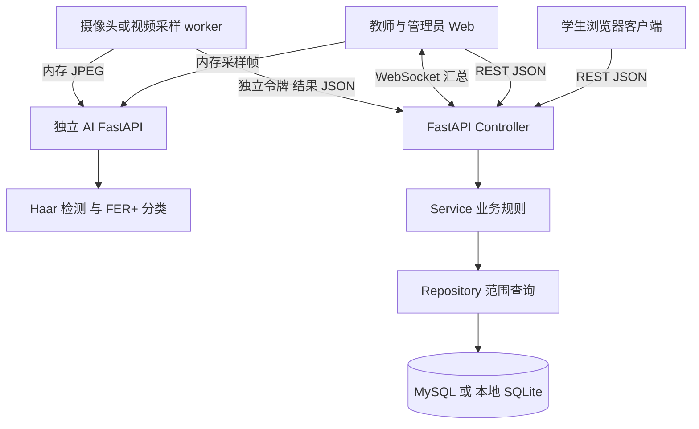
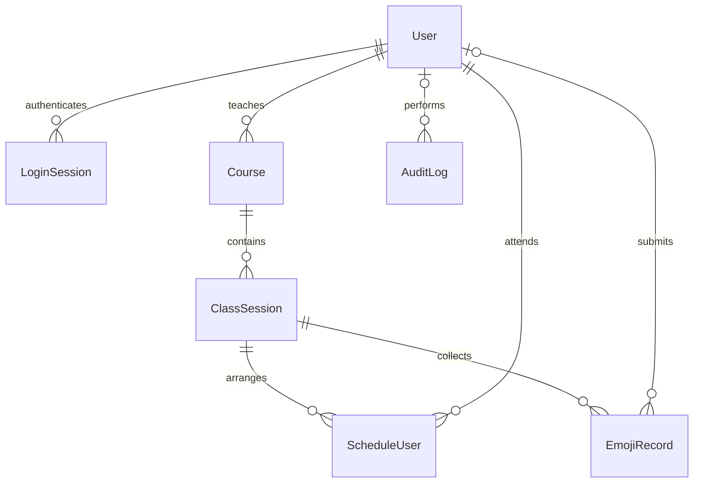
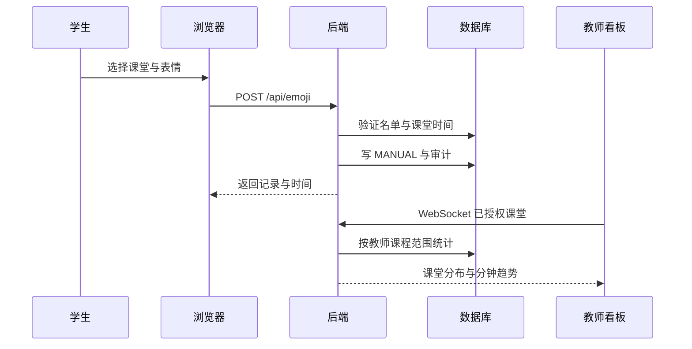
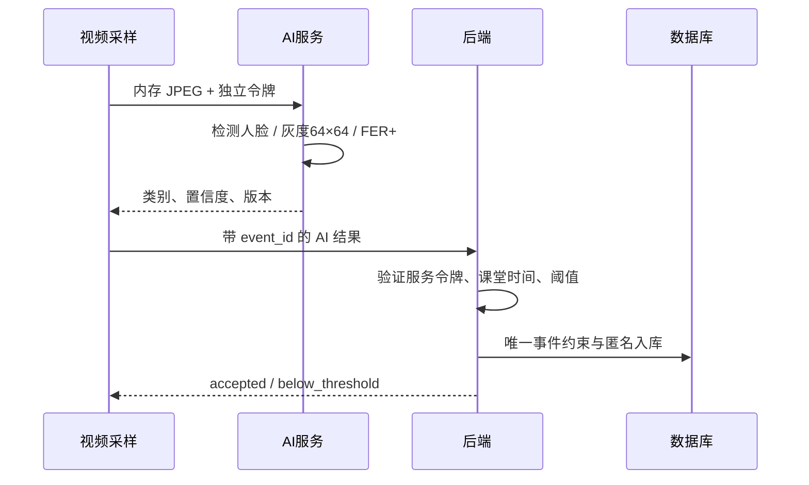

# 系统设计说明

## 架构与边界

浏览器端的视频帧实际经后端 `/api/ai/frame` 代理到 AI 服务；图中“内存采样帧”表示逻辑数据流，浏览器不持有服务令牌。worker 是可独立运行的采样客户端，直接访问 AI 服务并回传结果。

主后端负责身份认证、课堂安排、权限、入库、过滤、统计和审计。独立 AI 服务只接收图像字节并给出检测结果，不访问业务数据库。采样 worker 负责采样时钟、设备标识、事件编号、断线重试和回传；浏览器采样由管理员或教师主动开启。

## 修改版 MVC

学生、教师和管理员共用浏览器资源，按已登录角色展示不同页面。`model.js` 保存状态并封装 API 请求，`view.js` 根据状态渲染，`controller.js` 连接事件与请求。学生客户端可将其理解为 MVP：View 为模板与 DOM，Presenter 为控制模块，数据 Repository 为 Model 中的接口函数。

Web 管理端使用同样的三部分组织角色页面。后端 `main.py` 为 Controller，处理路由、会话和输入；`services.py` 实现排课版本更新、AI 入库、统计及 CSV 等规则；`repository.py` 集中实现课程和课堂数据范围查询；`models.py` 声明关系实体。数据校验独立放在 `schemas.py`。

“修改”体现在用户界面和数据存储被 REST 契约解耦，同时增加独立推理服务；后端 Controller 不直接承担界面绘制，客户端负责交互状态。

## 领域模型与 ER

| 实体 | 主键与关键字段 | 数据约束 |
|---|---|---|
| User | id、username、password_hash、role、email、active、created_at | username 唯一，role 三值，密码为 bcrypt 哈希 |
| LoginSession | token_hash、user_id、expires | 只保存会话摘要；会话到期、退出、改密和停用阻止继续访问 |
| Course | id、name、teacher_id | teacher_id 外键，创建时检查有效教师 |
| ClassSession | id、course_id、start_at、end_at、class_name、room、version | 结束晚于开始；version 正整数 |
| ScheduleUser | id、session_id、user_id、scheduled_at | 课堂与用户组合唯一；只允许有效学生 |
| EmojiRecord | id、user_id、session_id、emoji、timestamp、source、confidence、device_id、model_version、event_id | 七类枚举；来源枚举；AI 必须有置信度；事件号唯一 |
| AuditLog | id、actor_id、action、detail、created_at | 保存关键操作，无原始画面 |

人工记录必须关联学生；AI 记录默认 `user_id=null`。系统不做人脸身份识别，也不按人脸推断或绑定学生姓名。相同人在不同采样周期可能形成多条记录，因此“AI 数量”代表采样观测次数，不能当成独立学生人数。

## 主要交互

## 一致性和时间

名单全量替换和课堂版本递增在同一事务中完成。客户端发送看到的 version，后端执行带 version 条件的更新，冲突返回 409。已有反馈的课堂不可更改课程、班级和起止时间，避免历史统计被重新解释。

所有业务时间按 UTC 存储，接口输出带 `Z` 的 ISO 字符串；浏览器按本地显示。筛选起止时间由浏览器转换为含时区 ISO。AI 入库同时校验当前课堂处于进行中、采样时间属于课堂且未过期；重复事件返回原记录，不再次计数。

## 安全与隐私

后端独立执行角色和范围检查，界面菜单隐藏只用于操作引导。WebSocket 握手检查来源和会话，推送循环再次确认账号和课堂权限。AI 使用单独令牌，浏览器只调用主后端代理。密码不写日志，服务令牌不嵌入前端，Cookie 标记 HttpOnly 和 SameSite。

查询使用参数绑定，字段及枚举由 Pydantic 与数据库双重约束；CSV 对公式前缀加单引号。图像只在内存中解码和推理，不进入业务表、文件目录或请求日志。视频测试素材与推理数据存储分开，测试素材不是系统采集的用户画面。

## 可替换与扩展点

FER+ 的类别、预处理和结果映射封装在 AI 模块，后端通过统一 JSON 接口接收结果。替换模型时保留 emoji 枚举与置信度协议，并记录新的 model_version。若增加真正匿名的人工反馈、消息队列或 MCP 工具，需要补充相应的权限与统计口径，当前系统不依赖这些选做项。
